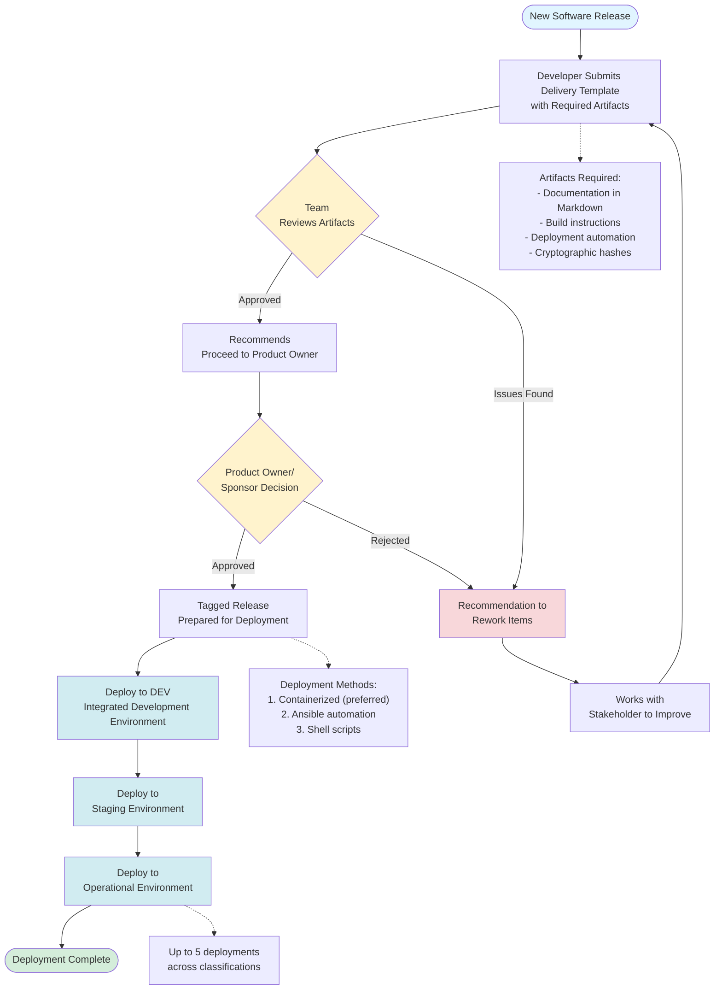

# Delivery Standard

[TOC]

## Template / Reference

*Template* - [Delivery Template](./009_Delivery_Template.md)

## Definition
A software delivery process standard is a set of guidelines and practices that describe how to create, test, and deliver software products to users in a reliable and efficient way. Simply put, it’s a rulebook that teams follow to make sure software is developed, checked for quality, and handed over to customers on time, with minimal errors and best results. 

## Purpose
The primary method of achieving a quality delivery is consistency.  By having a consistent way to deliver products and receive inputs the development team gains advantage and ultimately helps the Government team member out.

The specific list of enumerated requirements for a delivery are located at [Delivery Template](009_Delivery_Template.md).

## Requirements/Specifications/Guidelines

New projects / software applications hosted by our project will provide the documentation listed in the Delivery Template as minimal artifacts which must be reviewed by the team and if approved (meaning inspection content existence and spot check verification of validity) a recommendation to proceed or rework items provided to the Product Owner.  If the Sponsor approves deployment the targeted Tagged release of the software will be taken and used in the deployment.  Ideally containerized applications are desired, however automated deployments with preference for Ansible first, followed by Shell Scripts are minimal requirements.  If the Sponsor does not approve the release and concurs with rework items the team will work with the application stakeholder to improve the content sufficient for a deployment.  Deployments will start in the Integrated Development Environment (IDE DEV), followed by a Staging and then Operational deployment in the appropriate classification.  Considering the potential for up to five (5) deployments automation is the key to integration success for this project.

Utilize the delivery template and ensure you have the minimal documents avaialbe for inspection.  Ideally the artifacts will be located in the same repository as the project in Markdown format, however any format in plain text or MS Office suite formats is acceptable.  A manifest of URL's is authorized which points to the location of each artifact, however the team must have positive copies/control of each artifact for purposes of Authority to Operate (ATO) and similar Cybersecurity concerns.

The intent of having these artifacts is to ensure:
1. Reproducibility (building the application on project's infrastructure and deploying to the platform).
2. Accountability (understanding who did what and who is responsible).
3. Consistency (solid engineering practices are being followed).

The expectation is that a software delivery will be made either as a negotiated conversation due to size/bandwidth limitations (Artifactory comes to mind) or as an entire payload via repository or tarball (as examples).

## Measurable and Actionable

Actionable at delivery of a new software version release.  Ideally a post-commit after a Tagged software release will trigger an upload to the project repositories, negotiated with our admins, with notification to team members to start inspection and collaboration with the application stakeholder.

## Timeliness

Executed at each software tagged release during a post-commit (desired end-state).

## Reference(s)
 + Application Security and Development (ASD) Security Technical Implementation Guide (STIG) Version 6, Release 5, 2026/09/30 
   + APSC-DV-003140, Application files must be cryptographically hashed prior to deploying to  operational networks.
 + [DoDI 5000.87, October 2, 2020](https://www.esd.whs.mil/Portals/54/Documents/DD/issuances/dodi/500087p.PDF)

