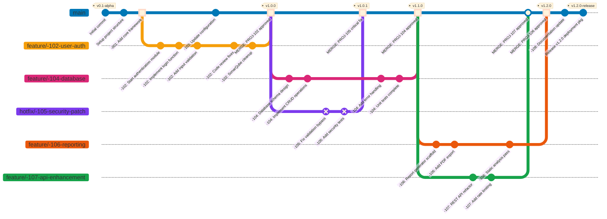

# Tracking System Standard

[TOC]

## Template / References

*Template* - [Tracking System Template](./012_TrackingSystem_Template.md)

## Definition:

A software tracking system for tracking issues in a software development project, explained simply, is a tool that helps teams keep track of problems, bugs, or tasks that come up during development. It records each issue, assigns it to the right person to fix, and monitors the progress until the problem is resolved.

## Purpose:

A tracking system makes managing bugs or tasks clearer, faster, and more efficient so the software can be improved and delivered more reliably as well as provide metrics for project performance and accountability.

## Requirements/Specifications/Guidelines:

A tracking system must:

+ Organize all reported issues in one place
+ Prioritize which problems to fix first
+ Allow team members to add notes and updates
+ Track how long issues take to get fixed
+ Keep everyone informed about the status of issues

**APSC-DV-003010 - Software Configuration Management**
 - Application must be modified using Trunk/Branch/Tag methodology
 - A Software repository management system required
 - Each modification must be tracked as a task
 - All modifications must be correlated to host/parent organization tracking/requirements system
 - Eligible deployment objects include: source code, configuration/settings files, and libraries

Establish a tracking system with commit messages utilizing Issue Id notation.

#### Commit Messages
When committing something use the -m flag to add a short commit message of the format:

`#<<Issue_Id by ing System>><<Optional:(Use Case Id)>><<Bug Fix|Feature|Documentation|Optimization>><<Short description of the change in past tense>>.`

*the pound system is required*

Commit messages must be in the past tense.

In general, try to group file changes wherever appropriate, so if your controller changes also involve updating something in a helper file, the one commit message can happily encompass the changes to both files. The message ought to reflect the main aim of the change.

Bug Fix - the change fixes a bug
Feature - the change adds a new feature (the usual issue type)
Documentation — The change is a documentation only change
Optimization - The change is an optimization of the code base without any functional changes
If your change does not fit any of these categories, use Feature. Likewise, if your change is not tied to an issue number you may use n/a instead.

So, to use the above example your commit would have the following message:

#132 Feature added cosine similarity to human selected comments versus generative selected comments.
#132 (ML-025) Feature added cosine similarity to human selected comments versus generative selected comments.

## Measurable and Actionable:

+ Evidence of a commits tied to issues by way of the tracking system.
+ Evidence of changes traceable from version release to tracking system to requirement.

## Timeliness:

+ Per commit of code to the Software Configuration Management Plan.
+ Per new or modified Story or Task.

## Reference(s):
 + [Software Engineering for Continuous Delivery of Warfighting Capability, 2023/04](https://www.cto.mil/wp-content/uploads/2023/07/SWE-Guide-April2023.pdf)
 + [DoW Enterprise DevSecOps Fundamentals, v 2.5, 2024/10](https://dodcio.defense.gov/Portals/0/Documents/Library/DoD%20Enterprise%20DevSecOps%20Fundamentals%20v2.5.pdf)
 + [NIST Special Publication 800-37 (“Risk Management Framework for Information Systems and Organizations"), Rev 2](https://nvlpubs.nist.gov/nistpubs/SpecialPublications/NIST.SP.800-37r2.pdf)
 + [NIST Secure Software Development Framework (SSDF), SP 800-218A](https://nvlpubs.nist.gov/nistpubs/SpecialPublications/NIST.SP.800-218A.pdf)
 + [CISA Securing the Software Supply Chain](https://www.cisa.gov/sites/default/files/publications/ESF_SECURING_THE_SOFTWARE_SUPPLY_CHAIN_DEVELOPERS.PDF)

## Visual

### Basic Git Workflow Example

### Advanced Git Workflow

```mermaid

graph TD
    Start([New Work Request]) --> Ticket[Create Ticket in<br/>Tracking System<br/>e.g., PROJ-123]
    
    Ticket --> TicketType{Ticket<br/>Type?}
    
    TicketType -->|Feature| Feature[Assign to Sprint/<br/>Development Cycle]
    TicketType -->|Bug Fix| BugFix[Prioritize Bug Fix]
    TicketType -->|Hotfix| Hotfix[Emergency Priority]
    
    Feature --> Trunk1[Pull Latest from<br/>Trunk/Main Branch]
    BugFix --> Trunk1
    Hotfix --> Trunk2[Pull Latest from<br/>Production Tag]
    
    Trunk1 --> CreateBranch[Create Feature Branch<br/>feature/PROJ-123-description]
    Trunk2 --> CreateHotfixBranch[Create Hotfix Branch<br/>hotfix/PROJ-123-description]
    
    CreateBranch --> DevWork[Developer Makes Changes<br/>on Local Branch]
    CreateHotfixBranch --> DevWork
    
    DevWork --> LocalCommit[Local Commits with<br/>Ticket Reference<br/>git commit -m 'PROJ-123: description']
    
    LocalCommit --> MoreWork{More Changes<br/>Needed?}
    MoreWork -->|Yes| DevWork
    MoreWork -->|No| LocalTest[Run Local Tests<br/>& Validation]
    
    LocalTest --> LocalPass{Tests<br/>Pass?}
    LocalPass -->|No| DevWork
    LocalPass -->|Yes| PushBranch[Push Branch to<br/>Remote Repository<br/>git push origin feature/PROJ-123]
    
    PushBranch --> UpdateTicket1[Update Ticket Status:<br/>'In Review']
    UpdateTicket1 --> CodeReview[Code Review Process]
    
    CodeReview --> ReviewDecision{Review<br/>Approved?}
    ReviewDecision -->|Changes Requested| DevWork
    ReviewDecision -->|Approved| StaticAnalysis[Run Static Code Analysis<br/>SonarQube & VCG]
    
    StaticAnalysis --> AnalysisResults{Critical<br/>Issues?}
    AnalysisResults -->|Yes| UpdateTicket2[Update Ticket with<br/>Analysis Results]
    UpdateTicket2 --> DevWork
    AnalysisResults -->|No| CompileCheck[Compile with<br/>Highest Warning Level]
    
    CompileCheck --> CompilePass{Warnings<br/>Present?}
    CompilePass -->|Yes| DevWork
    CompilePass -->|No| TestSuite[Run Full Test Suite<br/>Unit, Integration, Security]
    
    TestSuite --> TestPass{All Tests<br/>Pass?}
    TestPass -->|No| UpdateTicket3[Document Test Failures<br/>in Ticket]
    UpdateTicket3 --> DevWork
    TestPass -->|Yes| MergePrep[Prepare for Merge]
    
    MergePrep --> CheckoutTrunk[Checkout Trunk/Main<br/>git checkout main]
    CheckoutTrunk --> PullLatest[Pull Latest Changes<br/>git pull origin main]
    PullLatest --> MergeBranch[Merge Feature Branch<br/>git merge feature/PROJ-123]
    
    MergeBranch --> Conflicts{Merge<br/>Conflicts?}
    Conflicts -->|Yes| ResolveConflicts[Resolve Conflicts<br/>& Re-test]
    ResolveConflicts --> TestSuite
    Conflicts -->|No| CommitMerge[Commit Merge with Reference<br/>git commit -m 'MERGE: PROJ-123 approved']
    
    CommitMerge --> UpdateTicket4[Update Ticket Status:<br/>'Merged to Trunk']
    UpdateTicket4 --> ReadyRelease{Ready for<br/>Release?}
    
    ReadyRelease -->|No - More Features| CleanupBranch1[Delete Feature Branch<br/>git branch -d feature/PROJ-123]
    CleanupBranch1 --> End1([Continue Development])
    
    ReadyRelease -->|Yes| VersionUpdate[Update Version Number<br/>e.g., v1.2.0 → v1.3.0]
    
    VersionUpdate --> CreateTag[Create Version Tag<br/>git tag -a v1.3.0 -m 'Release v1.3.0']
    CreateTag --> DocumentRelease[Document Release Notes<br/>List All Tickets: PROJ-123, etc.]
    
    DocumentRelease --> HashFiles[Generate Cryptographic Hash<br/>of All Files - APSC-DV-003140]
    
    HashFiles --> CreatePackage[Create Deployment Package:<br/>- Source Code<br/>- Config Files<br/>- Libraries<br/>- Test Reports<br/>- Hash Values]
    
    CreatePackage --> PushTag[Push Tag to Remote<br/>git push origin v1.3.0]
    PushTag --> UpdateAllTickets[Update All Related Tickets:<br/>'Released in v1.3.0']
    
    UpdateAllTickets --> Deploy[Deploy to Production]
    Deploy --> PostDeploy[Post-Deployment<br/>Testing]
    
    PostDeploy --> DeploySuccess{Deployment<br/>Successful?}
    DeploySuccess -->|No| Rollback[Rollback to Previous Tag<br/>Create Rollback Ticket]
    Rollback --> Ticket
    DeploySuccess -->|Yes| CloseTickets[Close All Related Tickets<br/>PROJ-123: 'Resolved']
    
    CloseTickets --> Production([Production Environment<br/>Monitoring])
    
    %% SCM Tracking Process
    subgraph SCM_Tracking["SCM Tracking (APSC-DV-003010)"]
        T1[Every Commit Tracked]
        T2[Ticket Correlation Required]
        T3[Version History Maintained]
        T4[README.md Updated per Tag]
        T1 --> T2 --> T3 --> T4
    end
    
    %% Repository Structure
    subgraph Repo_Structure["Repository Structure"]
        R1[Trunk/Main Branch]
        R2[Feature Branches]
        R3[Hotfix Branches]
        R4[Version Tags]
        R5[Deployment Folder]
        R1 --> R2
        R1 --> R3
        R1 --> R4
        R4 --> R5
    end
    
    %% Ticket Lifecycle
    subgraph Ticket_Lifecycle["Ticket Lifecycle States"]
        TS1[Open/New]
        TS2[In Progress]
        TS3[In Review]
        TS4[Merged]
        TS5[Released]
        TS6[Closed]
        TS1 --> TS2 --> TS3 --> TS4 --> TS5 --> TS6
    end
    
    %% Styling
    classDef ticketClass fill:#fef3c7,stroke:#f59e0b,stroke-width:2px
    classDef gitClass fill:#d0f4de,stroke:#168aad,stroke-width:2px
    classDef testClass fill:#fce7f3,stroke:#db2777,stroke-width:2px
    classDef deployClass fill:#ddd6fe,stroke:#7c3aed,stroke-width:2px
    classDef decisionClass fill:#fef08a,stroke:#ca8a04,stroke-width:3px
    classDef processClass fill:#e1f5ff,stroke:#0077b6,stroke-width:2px
    
    class Ticket,UpdateTicket1,UpdateTicket2,UpdateTicket3,UpdateTicket4,UpdateAllTickets,CloseTickets ticketClass
    class CreateBranch,CreateHotfixBranch,LocalCommit,PushBranch,CheckoutTrunk,PullLatest,MergeBranch,CommitMerge,CreateTag,PushTag,CleanupBranch1 gitClass
    class LocalTest,TestSuite,StaticAnalysis,CompileCheck,PostDeploy testClass
    class VersionUpdate,DocumentRelease,HashFiles,CreatePackage,Deploy deployClass
    class TicketType,MoreWork,LocalPass,ReviewDecision,AnalysisResults,CompilePass,TestPass,Conflicts,ReadyRelease,DeploySuccess decisionClass
    class DevWork,CodeReview,MergePrep,ResolveConflicts processClass
```

### Git Workflow showing Ticket Correlation

```mermaid

graph LR
    subgraph Legend["Legend"]
        L1[Commit with Ticket ID]
        L2[Merge Commit]
        L3[Tag/Release]
        style L1 fill:#d0f4de,stroke:#168aad
        style L2 fill:#fef3c7,stroke:#f59e0b
        style L3 fill:#ddd6fe,stroke:#7c3aed
    end
    
    subgraph Main_Trunk["Main/Trunk Branch (Production)"]
        direction LR
        M1["commit: a1b2c3d<br/>TICKET-001: Initial setup<br/>Author: dev1<br/>Date: 2024-01-15"]
        M2["commit: e4f5g6h<br/>TICKET-003: Config update<br/>Author: dev2<br/>Date: 2024-01-20"]
        M3["commit: i7j8k9l<br/>MERGE: TICKET-102<br/>User auth complete<br/>Date: 2024-01-25"]
        M4["commit: m1n2o3p<br/>MERGE: TICKET-105<br/>Security hotfix<br/>Date: 2024-01-27"]
        M5["commit: q4r5s6t<br/>MERGE: TICKET-104<br/>Database module<br/>Date: 2024-02-01"]
        M6["commit: u7v8w9x<br/>Release preparation<br/>v1.2.0 final<br/>Date: 2024-02-05"]
        
        M1 --> M2 --> M3 --> M4 --> M5 --> M6
        
        T1["TAG: v0.1-alpha<br/>Commit: a1b2c3d"]
        T2["TAG: v1.0.0<br/>Commit: i7j8k9l<br/>Tickets: 102"]
        T3["TAG: v1.0.1<br/>Commit: m1n2o3p<br/>Tickets: 105"]
        T4["TAG: v1.1.0<br/>Commit: q4r5s6t<br/>Tickets: 104"]
        T5["TAG: v1.2.0<br/>Commit: u7v8w9x<br/>Tickets: 106, 107, 108"]
        
        M1 -.-> T1
        M3 -.-> T2
        M4 -.-> T3
        M5 -.-> T4
        M6 -.-> T5
    end
    
    subgraph Feature_Branch_102["Feature Branch: feature/TICKET-102-user-auth"]
        direction LR
        F1["commit: y1z2a3b<br/>TICKET-102: Start auth<br/>Author: dev3<br/>Date: 2024-01-16"]
        F2["commit: c4d5e6f<br/>TICKET-102: Login impl<br/>Author: dev3<br/>Date: 2024-01-18"]
        F3["commit: g7h8i9j<br/>TICKET-102: Validation<br/>Author: dev3<br/>Date: 2024-01-20"]
        F4["commit: k1l2m3n<br/>TICKET-102: Review fixes<br/>Author: dev3<br/>Date: 2024-01-23"]
        F5["commit: o4p5q6r<br/>TICKET-102: Sonar clean<br/>Author: dev3<br/>Date: 2024-01-24"]
        
        F1 --> F2 --> F3 --> F4 --> F5
    end
    
    subgraph Hotfix_Branch_105["Hotfix Branch: hotfix/TICKET-105-security"]
        direction LR
        H1["commit: s7t8u9v<br/>TICKET-105: Fix bypass<br/>Author: security-team<br/>Priority: CRITICAL<br/>Date: 2024-01-26"]
        H2["commit: w1x2y3z<br/>TICKET-105: Add tests<br/>Author: security-team<br/>Date: 2024-01-26"]
        
        H1 --> H2
    end
    
    subgraph Feature_Branch_104["Feature Branch: feature/TICKET-104-database"]
        direction LR
        D1["commit: a4b5c6d<br/>TICKET-104: Schema design<br/>Author: dev4<br/>Date: 2024-01-22"]
        D2["commit: e7f8g9h<br/>TICKET-104: CRUD ops<br/>Author: dev4<br/>Date: 2024-01-28"]
        D3["commit: i1j2k3l<br/>TICKET-104: Error handling<br/>Author: dev4<br/>Date: 2024-01-30"]
        D4["commit: m4n5o6p<br/>TICKET-104: Unit tests<br/>Author: dev4<br/>Date: 2024-01-31"]
        
        D1 --> D2 --> D3 --> D4
    end
    
    subgraph Ticketing_System["Ticketing System Correlation"]
        direction TB
        TK1["TICKET-102<br/>Status: Closed<br/>Type: Feature<br/>Released: v1.0.0<br/>Commits: 5<br/>Branch: feature/TICKET-102"]
        TK2["TICKET-105<br/>Status: Closed<br/>Type: Hotfix<br/>Released: v1.0.1<br/>Commits: 2<br/>Branch: hotfix/TICKET-105"]
        TK3["TICKET-104<br/>Status: Closed<br/>Type: Feature<br/>Released: v1.1.0<br/>Commits: 4<br/>Branch: feature/TICKET-104"]
        
        TK1 -.->|Tracks| F1
        TK1 -.->|Tracks| F2
        TK1 -.->|Tracks| F3
        TK1 -.->|Tracks| F4
        TK1 -.->|Tracks| F5
        
        TK2 -.->|Tracks| H1
        TK2 -.->|Tracks| H2
        
        TK3 -.->|Tracks| D1
        TK3 -.->|Tracks| D2
        TK3 -.->|Tracks| D3
        TK3 -.->|Tracks| D4
    end
    
    subgraph Deployment_Artifacts["Deployment Package Structure"]
        direction TB
        PKG1["v1.2.0 Deployment<br/>────────────────"]
        PKG2["Source Code<br/>├─ All .c, .sh, .md files"]
        PKG3["Configuration<br/>├─ Settings files"]
        PKG4["Libraries<br/>├─ Runtime dependencies"]
        PKG5["Documentation<br/>├─ README.md (Tag history)<br/>├─ Test Reports<br/>├─ SonarQube Report"]
        PKG6["Checksums<br/>└─ SHA256SUMS<br/>   (Cryptographic hashes)"]
        
        PKG1 --> PKG2
        PKG1 --> PKG3
        PKG1 --> PKG4
        PKG1 --> PKG5
        PKG1 --> PKG6
    end
    
    %% Branch connections to trunk
    M2 -.->|Branch from| F1
    F5 -.->|Merge to| M3
    
    M3 -.->|Branch from| H1
    H2 -.->|Merge to| M4
    
    M2 -.->|Branch from| D1
    D4 -.->|Merge to| M5
    
    T5 -.->|Deployment Package| PKG1
    
    %% Styling
    classDef commitStyle fill:#d0f4de,stroke:#168aad,stroke-width:2px
    classDef mergeStyle fill:#fef3c7,stroke:#f59e0b,stroke-width:2px
    classDef tagStyle fill:#ddd6fe,stroke:#7c3aed,stroke-width:3px
    classDef ticketStyle fill:#fecaca,stroke:#dc2626,stroke-width:2px
    classDef deployStyle fill:#e1f5ff,stroke:#0077b6,stroke-width:2px
    
    class M1,M2,F1,F2,F3,F4,F5,H1,H2,D1,D2,D3,D4 commitStyle
    class M3,M4,M5,M6 mergeStyle
    class T1,T2,T3,T4,T5 tagStyle
    class TK1,TK2,TK3 ticketStyle
    class PKG1,PKG2,PKG3,PKG4,PKG5,PKG6 deployStyle
```

