# 📘Software Development Standard

[TOC]

## 🔗 Template / Reference

*Template* - [Software Development Lifecycle Template](./013_SoftwareDevelopmentLifecycle_Template.md)

## 📖 Definition

The Software Development Life Cycle (SDLC) is a structured process used by development teams to design, build, test, and deploy software. It consists of seven key stages that guide the creation of software from initial concept to ongoing support:

1. Planning (defining project goals, requirements, scope, schedule, and resources)
2. Requirements Analysis (gathering and analyzing detailed user and business requirements)
3. Design (creating the software architecture, system design, and user interface plans)
4. Implementation or Coding (where developers write the actual code according to designs and standards)
5. Testing (verifying the software works correctly, is free of bugs, and meets requirements through various tests)
6. Deployment (releasing the software to users and configuring it in the production environment)
7. Maintenance (providing ongoing support, fixing issues, and updating the software over time).

Note that new technology added to the project needs [PDR/CDR](./013a_PDR_CDR_SDLC_Process.md) work done.

## 🎯 Purpose

The purpose of the SDLC is to provide a roadmap that guides each phase of software development methodically, helping to ensure efficient, predictable, and successful software delivery. It helps development teams ensure that the software meets user needs, is delivered on time, and is of high quality. By following a structured approach, the SDLC reduces risks, improves project management, and enables teams to track progress systematically through each stage. Different methodologies such as Waterfall, Agile, and Spiral apply these stages in varied ways, allowing teams to tailor the process to their specific project needs while maintaining the core framework that promotes quality, security, and successful outcomes.

## 🧩 Requirements/Specifications/Guidelines

+ Requirements
+ Tracking System relating requirements to actions
+ Software Configuration Management (SCM)
+ Commits that relate changes to the Tracking System and by extension Requirements
+ Peer Review
+ Branch and Tag methods (see Configuration Management Plan)
+ Updates to documents, issues, and commits
+ Support for Deployment

Based on the references documentation, here are the key guidelines and requirements:

### 🟦 1.  Security Requirements

**APSC-DV-003400 - Secure Design Principal Training**
- All program management levels must receive security training on integrating secure development practices
- Development team members (designers/architects, developers/programmers, testers, application managers) must receive training on secure design principles
- Training must cover the entire SDLC and newly discovered vulnerability types
- Training must be conducted at least annually
- This is in addition to DoW 8570 training requirements

**APSC-DV-003010 - Software Configuration Management**
- Application must be modified using Trunk/Branch/Tag methodology
- Git repository management system required
- Each modification must be tracked as a task
- All modifications must be correlated to host/parent organization tracking/requirements system
- Eligible deployment objects include: source code, configuration/settings files, and libraries

**APSC-DV-003235 - Error Handling**
- Application must not be subject to error handling vulnerabilities
- Custom error/exception class must be designed to prevent stack trace exposure to end-users
- Error output should go to logs based on log levels
- Obfuscated/reduced output displayed to end users
- Application designed to "fail fast" if contract is broken

**APSC-DV-002530, APSC-DV-002560 - Input Validation**
- Validate input from all untrusted data sources
- Be suspicious of external data sources including command line arguments, network interfaces, environmental variables, and user-controlled data
- All user input must be validated (see validate_ routines)

**ASPC-DV-003140 - Cryptographic Hashing**
- Application files must be cryptographically hashed prior to deploying to Government operational networks

### 🟩 2. Development Standards & Guidelines

+ **Establish Process Standards**
+ **Utilize Version Control**
+ **Identify and Plan Deployment Package Requirements**

### 🟨 3.  Establish Coding Best Practices

+ **Utilize Local Variables**
+ **Utilize Methods / Functions**
+ **Team Evaluate and Consider Imports/Library References**
+ **Establish and Follow Error Handling Best Practices**
+ **Utilize Abstraction**
+ **Apply Source Formatting**
+ **Execute Static Code Analysis**

### 🟧 4.  Top 10 Secure Coding Practices (Software Engineering Institute)

1. **Validate Input** - From all untrusted data sources
2. **Heed Compiler Warnings** - Use highest warning level, eliminate warnings by modifying code
3. **Architect and Design for Security Policies** - Implement and enforce security policies in architecture
4. **Keep It Simple** - Simple and small designs reduce implementation errors
5. **Default Deny** - Base access decisions on permission rather than exclusion; access denied by default
6. **Principle of Least Privilege** - Execute with minimum necessary privileges; elevated permissions held for minimum time
7. **Sanitize Data** - Sanitize all data passed to complex subsystems (command shells, databases, COTS components)
8. **Defense in Depth** - Use multiple defensive strategies
9. **Quality Assurance** - Use fuzz testing, penetration testing, source code audits, and independent security reviews
10. **Secure Coding Standard** - Develop and/or apply secure coding standard for target language and platform

### 🟥5. Security-Specific Guidelines

+ **System Executables should only be called after team review and lack of any other choices, consider using checksums**
+ **Static URLs in Code are not allowed, use configuration files. **
+ **Define and Document Compiler Settings when appropriate as well as the actual build process, automate if possible**
+ **Establish Testing Requirements, use Unit Testing minimally**
+ **Follow a Deployment Process and document what it takes to implement this change**

## 📏 Measurable and Actionable

Metrics provide comprehensive visibility into the SDLC process, enabling teams to identify areas for improvement, ensure compliance with security requirements, and deliver high-quality software consistently.

Note that these metrics represent potential, not all must be utilizes, your actual SDLC documentation should enumerate which metrics you are gathering and wny.

Based on the reference documentation, Government mandates, and industry best practices, here are key metrics that can be used to measure the software development lifecycle:

### 📊 Security Compliance Metrics

**Training Compliance**
- Percentage of team members completing annual secure design training (APSC-DV-003400)
- Time since last security training update

**Vulnerability Management**
- Number of critical security issues identified in static code analysis
- Time to resolve critical security vulnerabilities
- Percentage of releases with zero critical security issues
- Number of security findings from SonarQube and Visual Code Grepper
- Input validation coverage percentage

**Compliance Adherence**
- Number of APSC-DV violations per release

### 📊 Code Quality Metrics

**Static Analysis**
- Number of critical, major, minor, and info-level issues from SonarQube
- Code coverage percentage
- Technical debt ratio
- Code duplication percentage
- Cyclomatic complexity scores
- Compiler warnings count (target: zero)

**Code Review**
- Percentage of code reviewed before integration
- Average time for code review completion
- Number of defects found during code review
- Review feedback incorporation rate

**Coding Standards Compliance**
- Adherence to formatting standards (uncrustify compliance)
- Import/library reference organization compliance
- Method complexity (methods taking >60 seconds to understand)
- Local variable naming convention compliance

### 📊 Version Control & Configuration Management Metrics

**SCM Effectiveness (APSC-DV-003010)**
- Percentage of changes tracked with task correlation
- Branch lifecycle duration
- Merge conflict frequency
- Tag creation frequency and regularity
- Number of unauthorized code changes
- Repository commit frequency and patterns

**Documentation Quality**
- Version history completeness for each release
- README.md currency and accuracy
- Change request documentation completeness
- Deployment package completeness (test reports, Sonar reports, UAT reports)

### 📊 Testing Metrics

**Test Coverage**
- Unit test coverage percentage
- Integration test coverage percentage
- Security test coverage (input validation, error handling)
- Fuzz testing coverage and findings
- Penetration testing results

**Defect Metrics**
- Defects found per phase (requirements, design, coding, testing)
- Defect density (defects per lines of code)
- Defect escape rate (defects found in production)
- Mean time to defect resolution
- Defect reopening rate
- Critical defects blocked from release

**Test Effectiveness**
- Pass/fail rate for each testing phase
- Test execution time
- Number of test cycles required before deployment
- User acceptance test approval rate

### 📊 Development Cycle Metrics

**Velocity & Throughput**
- Sprint velocity (for Agile methodologies)
- Lead time (time from requirement to deployment)
- Cycle time (time from coding start to deployment)
- Number of releases per time period
- Feature completion rate

**Rework Metrics**
- Percentage of code requiring rework after code review
- Percentage of code requiring rework after static analysis
- Number of deployment rollbacks
- Time spent on rework vs. new development

### 📊 Deployment Metrics

**Deployment Success**
- Deployment success rate (first-time right)
- Number of rollbacks required
- Post-deployment defect rate
- Time to complete deployment process
- Stakeholder acceptance rate
- Mean time between deployments

**Deployment Quality**
- Cryptographic hash verification success rate (ASPC-DV-003140)
- Deployment package completeness
- Configuration accuracy in production
- Environment parity issues
- Large changes incorporate a Preliminary Design Review and Critical Design Review

### 📊 Maintenance & Support Metrics

**Issue Management**
- Mean time to acknowledge issues
- Mean time to resolution (MTTR)
- Number of bug fixes vs. feature requests
- Issue recurrence rate
- Backlog size and aging

**System Stability**
- Number of production incidents
- System uptime percentage
- Error rate in production logs
- Performance degradation incidents

### 📊 Process Adherence Metrics

**SDLC Phase Compliance**
- Percentage of projects completing all seven SDLC phases
- Phase gate pass/fail rates
- Documentation completeness at each phase
- Stakeholder sign-off timing

**Standards Compliance**
- Adherence to PAL (Process Asset Library) standards
- Compliance with organizational kick-off meeting standards
- Best practices adoption rate
- Secure coding standard compliance percentage

### 📊 Team Performance Metrics

**Productivity**
- Story points completed per sprint
- Number of completed features per release

**Collaboration**
- Code review participation rate
- Internal code review completion time
- Team member training completion rates
- Cross-functional collaboration incidents

### 📊 Risk & Quality Metrics

**Risk Management**
- Number of identified risks per phase
- Risk mitigation effectiveness
- Security vulnerability discovery rate
- Time to address identified risks

**Quality Assurance**
- Independent security review findings
- External reviewer recommendations implemented
- Code audit findings
- Quality gate failure rate

### 📊 Efficiency Metrics

**Resource Utilization**
- Actual vs. planned effort variance
- Budget variance (actual vs. planned costs)
- Schedule variance (actual vs. planned timeline)
- Resource allocation efficiency

**Automation**
- Percentage of automated tests
- Build automation success rate
- Deployment automation effectiveness
- Static analysis automation coverage

### 📊Key Performance Indicators (KPIs) Dashboard Example

**Critical KPIs to Track:**
1. Deployment success rate (target: >95%)
2. Zero critical security issues per release (target: 100%)
3. Code coverage (target: >80%)
4. Training compliance (target: 100% annually)
5. Mean time to resolution for critical bugs (target: <24 hours)
6. Technical debt ratio (target: <5%)
7. Defect escape rate (target: <2%)
8. Compiler warnings (target: 0)
9. Post-deployment rollback rate (target: <5%)
10. Stakeholder acceptance rate (target: >95%)

**Actionable Insights:**
- Set baseline measurements
- Define improvement targets
- Track trends over time
- Identify bottlenecks and pain points
- Correlate metrics to outcomes
- Use metrics to drive continuous improvement

## ⏱️ Timeliness

Applicable for every software code change (configuration files do not count).

## 🖼️ Visual

```mermaid
graph TD
    Start([Project Initiation]) --> Planning[Planning Phase]
    
    Planning --> Planning_Tasks[Define Goals, Scope,<br/>Schedule & Resources]
    Planning_Tasks --> Security_Training[Secure Design Principles<br/>Training - APSC-DV-003400]
    Security_Training --> Requirements[Requirements Analysis]
    
    Requirements --> Req_Tasks[Gather & Analyze<br/>User & Business Requirements]
    Req_Tasks --> Design[Design Phase]
    
    Design --> Design_Tasks[Create Architecture,<br/>System Design & UI Plans]
    Design_Tasks --> Security_Design[Apply Secure<br/>Design Principles]
    Security_Design --> SCM_Setup[Configure SCM<br/>Git Repository - APSC-DV-003010]
    SCM_Setup --> Implementation[Implementation/Coding]
    
    Implementation --> Code_Dev[Developers Write Code<br/>According to Standards]
    Code_Dev --> Code_Review{Code Review &<br/>Best Practices Check}
    
    Code_Review -->|Issues Found| Code_Dev
    Code_Review -->|Approved| Static_Analysis[Static Code Analysis<br/>SonarQube & VCG]
    
    Static_Analysis --> Critical_Check{Critical<br/>Issues?}
    Critical_Check -->|Yes| Code_Dev
    Critical_Check -->|No| Compiler_Check[Compile with<br/>Highest Warning Level]
    
    Compiler_Check --> Warning_Check{Warnings<br/>Present?}
    Warning_Check -->|Yes| Code_Dev
    Warning_Check -->|No| Testing[Testing Phase]
    
    Testing --> Unit_Tests[Unit Testing]
    Unit_Tests --> Integration_Tests[Integration Testing]
    Integration_Tests --> Security_Tests[Security Testing<br/>Input Validation & Error Handling]
    Security_Tests --> Fuzz_Tests[Fuzz Testing &<br/>Penetration Testing]
    Fuzz_Tests --> UAT[User Acceptance Testing]
    
    UAT --> Test_Results{All Tests<br/>Passed?}
    Test_Results -->|Failed| Code_Dev
    Test_Results -->|Passed| Version_Tag[Create Version Tag<br/>Update Documentation]
    
    Version_Tag --> Hash_Files[Cryptographic Hash<br/>of Files - ASPC-DV-003140]
    Hash_Files --> Deployment_Package[Create Deployment Package<br/>- Source Code<br/>- Config Files<br/>- Libraries<br/>- Test Reports]
    
    Deployment_Package --> Deploy_Prep[Deployment Preparation]
    Deploy_Prep --> Deployment[Deployment to Production]
    
    Deployment --> Functional_Test[Post-Deployment<br/>Functional Testing]
    Functional_Test --> Stakeholder_Review[Stakeholder Review &<br/>Acceptance]
    
    Stakeholder_Review --> Deploy_Success{Deployment<br/>Successful?}
    Deploy_Success -->|Issues| Rollback[Rollback Procedures]
    Rollback --> Code_Dev
    Deploy_Success -->|Success| Production[Production Environment]
    
    Production --> Maintenance[Maintenance & Support]
    
    Maintenance --> Monitor[Monitor Performance<br/>& Security]
    Monitor --> Issues{Issues or<br/>Updates Needed?}
    Issues -->|Bug Fixes| Bug_Fix[Create Bug Fix<br/>Change Request]
    Issues -->|New Features| Feature_Request[Create Feature<br/>Change Request]
    Issues -->|No Issues| Monitor
    
    Bug_Fix --> Planning
    Feature_Request --> Planning
    
    %% Parallel Security Activities
    Planning -.-> Annual_Training[Annual Security Training<br/>& Vulnerability Updates]
    Annual_Training -.-> Security_Review[Ongoing Security Reviews]
    Security_Review -.-> Maintenance
    
    %% Configuration Management
    SCM_Setup -.-> SCM_Track[SCM Tracking:<br/>- Trunk/Branch/Tag<br/>- Task Correlation<br/>- Version History]
    SCM_Track -.-> Code_Dev
    
    %% Style Definitions
    classDef planningClass fill:#e1f5ff,stroke:#0077b6,stroke-width:2px
    classDef designClass fill:#d0f4de,stroke:#168aad,stroke-width:2px
    classDef implementClass fill:#fef3c7,stroke:#f59e0b,stroke-width:2px
    classDef testingClass fill:#fce7f3,stroke:#db2777,stroke-width:2px
    classDef deployClass fill:#ddd6fe,stroke:#7c3aed,stroke-width:2px
    classDef maintenanceClass fill:#fed7aa,stroke:#ea580c,stroke-width:2px
    classDef securityClass fill:#fecaca,stroke:#dc2626,stroke-width:2px
    classDef decisionClass fill:#fef08a,stroke:#ca8a04,stroke-width:3px
    
    class Planning,Planning_Tasks,Requirements,Req_Tasks planningClass
    class Design,Design_Tasks,Security_Design designClass
    class Implementation,Code_Dev,Compiler_Check implementClass
    class Testing,Unit_Tests,Integration_Tests,Security_Tests,Fuzz_Tests,UAT testingClass
    class Deploy_Prep,Deployment,Deployment_Package,Hash_Files,Version_Tag,Functional_Test,Stakeholder_Review,Production deployClass
    class Maintenance,Monitor,Bug_Fix,Feature_Request maintenanceClass
    class Security_Training,Static_Analysis,Annual_Training,Security_Review,SCM_Setup,SCM_Track securityClass
    class Code_Review,Critical_Check,Warning_Check,Test_Results,Deploy_Success,Issues decisionClass
```

## 📚 Reference(s)
 + 🏛️[Application Security Development (ASD) Security Technical Implementation Guide (STIG) version 6, release 5 (APSC-DV-003400)](https://www.cyber.mil/stigs/downloads)
   + APSC-DV-003400, The Program Manager must verify all levels of program management, designers, developers, and testers receive annual security training pertaining to their job function.
 + 🏛️[Software Engineering for Continuous Delivery of Warfighting Capability, 2023/04](https://www.cto.mil/wp-content/uploads/2023/07/SWE-Guide-April2023.pdf)
 + 🏛️[DoW Enterprise DevSecOps Fundamentals, v 2.5, 2024/10](https://dodcio.defense.gov/Portals/0/Documents/Library/DoD%20Enterprise%20DevSecOps%20Fundamentals%20v2.5.pdf)
 + 🏛️[NIST Special Publication 800-37 (“Risk Management Framework for Information Systems and Organizations"), Rev 2](https://nvlpubs.nist.gov/nistpubs/SpecialPublications/NIST.SP.800-37r2.pdf)
 + 🏛️[NIST Secure Software Development Framework (SSDF), SP 800-218A](https://nvlpubs.nist.gov/nistpubs/SpecialPublications/NIST.SP.800-218A.pdf)
 + 🏛️[CISA Securing the Software Supply Chain](https://www.cisa.gov/sites/default/files/publications/ESF_SECURING_THE_SOFTWARE_SUPPLY_CHAIN_DEVELOPERS.PDF)

