# 📘 Integrated Deployment Environment (IDE) Standard

[TOC]

## 🔗 Template / Reference

No explicit template or reference exists.  The SOP for using this environment is encapsulated within this document.

## 📖 Definition

An integrated deployment environment is a unified setup for software development and deployment that improves the process of moving code from development to a production environment. The  environment replicates the Staging / Operations environments to ensure deployment of any solution has a reasonable chance of success when engaging the Staging environment.  This is the first stop for the migration of code from a developer's local environment prior to Staging release.  

## 🎯 Purpose

This standard governs the activities of all application developers creating, deploying, or maintaining applications within the project environment, hosted on the project environment (hereinafter referred to as "DEV"). The purpose of this standard is to ensure the security, stability, and operational integrity of the DEV environment by strictly controlling access to services and resources. 

To facilitate a smooth transition for development teams, the DEV environment will be configured to closely mirror the architecture and operational patterns of the on-premise environment.  DEV will utilize automation to the greatest extent possible using infrastructure as code principles.

By using an Integrated Deployment Environment (IDE) the teams ensure:

+ ✅ Consistent deployments: The application can run reliably in development, testing, and production environments by simply adjusting configuration files rather than altering code.

+ ✅ Security and compliance: Sensitive data such as credentials and access keys on the Staging / Operation environment have no chance of spillage.

+ ✅ Rapid updates and scaling: Configuration changes can be made quickly, even in real-time, to accommodate updates, incident response, or scaling demands—without downtime or code changes.

+ ✅ Simplified maintenance: Structured, centralized documentation reduces complexity in multi-environment scenarios and facilitates troubleshooting, onboarding, and knowledge transfer.

+ ✅ Requirements/Specifications/Guidelines: The IDE must exist and be respected by ensuring all team members utilizing this environment understand the rules of engagement.

+ ✅ Measurable and Actionable: Every deployment to the Staging / Operational environment must be proceeded by a deployment to the IDE.  Approval to move to the Staging environment requires proof of deployment to the IDE.

## 🧩 Requirements/Specifications/Guidelines

### 🟦 1. Scope 

This standard applies to all company personnel, contractors, and third-party developers (collectively, "Developers") who require access to the project DEV environment for application development and deployment activities. This standard covers all actions taken by Developers within the Management Console, via the Command Line Interface (CLI), or through any SDK or API interacting with the DEV account. 

Internal admin team norms will be documented as working papers / processes thus the intent of this standard is to ensure a clear understanding of Developer and Admin responsibilities for this aspect of our Development Security and Operations (DevSecOps) efforts.
 Statement 

While the current configuration of the DEV environment grants developers broad permissions for operational flexibility, all personnel are mandated to operate under a self-governed Principle of Least Privilege. 

This means that although you may have the technical ability to access or modify various Cloud services, you are required by this standard to limit your actions strictly to the resources necessary for your assigned application development tasks. 

Developers must operate as if their permissions are limited only to the activities outlined in Section 5.0 (Permitted Activities). Any action taken outside the scope of your direct responsibilities, even if technically possible, is a violation of this standard and may impact the stability and security of the shared environment. The goal is to move towards a more restrictive, technically enforced model in the future, and adherence to this principle is critical. 

Developers will be granted read-only access, initially, and extended more advanced permissions based on mission need on an "as needed" basis only reverted back to read-only when the advanced permissions are no longer required.

### 🟩 2. Access to the DEV Environment 

All personnel requiring new or modified access to the project DEV environment must submit a signed formal request. 

To request access, please send an email to your sponsor with the following information: 

Full Name 

Application Name / Project 

Justification for Access 

The process of onboarding is managed by the Government representative.

### 🟨 3.  Permitted Activities 

Developers are permitted to perform the following actions only on their assigned EC2 instance(s) : 

+ Access: Securely connect to the instance via approved methods (e.g.Cloud Systems Manager Session Manager). 

+ Application Deployment: Deploy, update, and manage their application code, binaries, and related artifacts. 

+ Dependency Management: Install and configure application runtimes, libraries, and other software dependencies required for the application to function. 

+ Service Management: Start, stop, and restart application-specific services or processes running within the instance's operating system. 

+ Log and Performance Monitoring: Access application-level logs and use operating system tools to monitor the performance of their application. 

Any action related to Operating System modification must be cleared with the admin team first.  The Administrative team expects developers to have an automated deployment process by way of: 1) Ansible 2) Bash Shell execution unless the operation simply does not lend itself to automation (User Interfaces from a vendor that cannot be scripted).

### 🟧 4.  Prohibited Activities 

To maintain the security and stability of the shared DEV environment, the following activities are strictly prohibited. Even though your account permissions may allow these actions, performing them is a direct violation of this standard. 

No Unapproved Access to Other Cloud Services: Creating, configuring, modifying, or deleting any other Cloud resources without following the formal Exception Request Process. This includes, but is not limited to: 

+ Identity and Access Management (IAM) Users, Roles, or Policies 

+ Simple Storage Service (S3) Buckets 

+ Relational Database Service (RDS) Instances 

+ Lambda Functions, VPCs, Security Groups, Elastic Load Balancers, etc. 

+ No Unapproved Infrastructure-Level Changes to EC2 Instances: Modifying the underlying DEV configuration of an instance from the console/CLI is prohibited. This refers to the instance's infrastructure, not OS-level modifications made inside the instance (which are covered in Section 5.0 and 7.0). Prohibited infrastructure-level changes include: 

+ Changing the instance type (e.g., from t3.micro to m5.large). 

+ Attaching, detaching, or modifying EBS volumes or network interfaces. 

+ Terminating any instance. This action is strictly forbidden. 

+ No Non-Standard Software Installation: To maintain critical parity with the on-premise environment, all software installed in DEV must be a version/application that is approved for and accessible in the on-prem environment. While your permissions may allow you to download and install other software, doing so is a standard violation. This rule ensures application compatibility and simplifies security management across all environments. 

+ Stopping, Starting, or Rebooting a shared EC2 instance that hosts multiple applications. 

***Exception:*** These actions (stop, start, reboot) are permissible only on a dedicated EC2 instance that runs no other team's applications. It is the developer's responsibility to verify the instance's status as non-shared before taking action. 

All requests for infrastructure changes (e.g., firewall rules, new databases, load balancers) must be submitted as a service request to the Cloud Operations team as per Section 8.0. 

### 🟦 5. Shared Instance Protocol 

It is common for multiple applications to be co-hosted on a single EC2 instance within the project environment. This shared tenancy requires strict coordination to prevent service disruptions. 

+ Notification Requirement: Before performing any action that could impact the instance's operating system, shared libraries, or overall performance (e.g., installing a new system-wide dependency, restarting a core service, or performing a resource-intensive task), the Developer must provide advance notification. 

+ Communication Channel: Notifications must be posted in the designated communication channel (e.g., a specific Slack/Teams channel, JIRA board, or email distribution list) at least [e.g., 4 business hours] in advance. 

+ Notification Content, the notification must include: 

  + The EC2 Instance ID and Name. 

  + The application(s) you are working on. 

  + Ticket Issue Id from the tracking system.

  + A clear description of the planned change. 

  + The scheduled date and time of the change. 

  + The estimated duration and potential impact. 

+ Conflict Resolution: If another team identifies a conflict with the proposed change, it is the responsibility of the involved parties to coordinate and find a mutually agreeable time. The Cloud Operations team can be engaged to mediate if a resolution cannot be reached. 

### 🟩 6.  Exception Request Process 

If an application has a legitimate technical requirement for a service other than EC2 (e.g., an S3 bucket for file storage or an RDS database), access will not be granted directly to the Developer. 

Instead, the Developer must submit a formal "Infrastructure Request" ticket to the Cloud Operations team. The request must include: 

+ An Issue Ticket Id reference in the project's tracking system.

+ A detailed business and technical justification for the resource. 

+ The specific configuration required (e.g., S3 bucket name, RDS instance size). 

+ An access pattern description (how the application will connect to the resource). 

The Cloud Operations team will review the request. If approved, the team will provision the resource and provide the application with the necessary credentials and connection details (e.g., database endpoint, IAM Role for EC2). 
 

### 🟨 7.  Enforcement and Compliance 

+ Monitoring: All actions within the project are logged and monitored. This logging provides full visibility into all actions taken by all users. 

+ Audits: The Cloud Operations team will conduct periodic audits of CloudTrail logs to ensure all actions align with project requirements and adhere to this standard. 

+ Violations: Unauthorized activity or failure to comply with the self-governed Principle of Least Privilege outlined in this standard will be treated as a security incident. Non-compliance may result in immediate revocation of access, and further disciplinary action in accordance with company standard. 

## 📏 Measurable and Actionable

+ Lack of Issue Ticket Id's represents a failure to trace a change request to a change in the system and thereby a lack of Configuration Management (CM) compliance.  Monitoring of submissions will be key for administrators to ensure developers honor the standard.

+ Logged changes to the Non-Permitted actions by a developer should be monitored and reported to the Project Manager (PM) to ensure their cognizance which allows them to address concerns over lack of process adherence.

+ Administrative team will have a consistently formatted, managed, and centrally located database, in whatever form they deem appropriate, of requests.  Numbers of requests from developers should be measurable and help provide input into the flux of project changes as well as how well DevSecOps principles are being followed.

## ⏱️ Timeliness

Appropriate with each Developer need for access.

## 🖼️ Visual

```mermaid
graph TB
    Start([Developer Needs DEV Access])
    
    Start --> AccessRequest[Submit Access Request<br/>Email to Government Rep<br/>Include: Name, App, Justification]
    
    AccessRequest --> AccessGranted{Access<br/>Granted?}
    
    AccessGranted -->|Yes - Read-Only Initially| IDE[Work in IDE Environment<br/>Integrated Deployment Environment]
    AccessGranted -->|No| End1([Access Denied])
    
    IDE --> IDEDeploy[Deploy & Test in IDE]
    IDEDeploy --> IDESuccess{IDE Deploy<br/>Successful?}
    
    IDESuccess -->|No| IDEFix[Fix Issues in IDE]
    IDEFix --> IDEDeploy
    
    IDESuccess -->|Yes - Required Before Staging| RequestStaging[Request Staging Deployment<br/>With Proof of IDE Success]
    
    RequestStaging --> NeedAdvanced{Need Advanced<br/>Permissions?}
    
    NeedAdvanced -->|Yes| RequestAdvanced[Request Advanced Permissions<br/>Mission Need Justification]
    NeedAdvanced -->|No| PermittedActions
    
    RequestAdvanced --> AdvancedGranted{Granted?}
    AdvancedGranted -->|Yes - Temporary| PermittedActions
    AdvancedGranted -->|No| PermittedActions[Use Read-Only Access]
    
    PermittedActions --> CheckShared{Shared EC2<br/>Instance?}
    
    CheckShared -->|Yes| Notify[Post Notification 4hrs+ Advance<br/>Include: Instance ID, App, Ticket ID,<br/>Description, Time, Duration, Impact]
    CheckShared -->|No - Dedicated| DirectWork
    
    Notify --> Conflict{Conflict<br/>Reported?}
    Conflict -->|Yes| Coordinate[Coordinate with Other Teams<br/>Find Agreeable Time]
    Conflict -->|No| DirectWork
    
    Coordinate --> DirectWork[Perform Permitted Activities]
    
    DirectWork --> PermittedBox[PERMITTED ACTIONS<br/>On Assigned EC2 Only:<br/>• Secure Connection via SSM<br/>• Deploy Application Code<br/>• Install Dependencies<br/>• Manage App Services<br/>• Monitor Logs & Performance<br/>• OS Changes Pre-Approved by Admin]
    
    PermittedBox --> NeedOtherService{Need Other<br/>Service?}
    
    NeedOtherService -->|Yes| InfraRequest[Submit Infrastructure Request<br/>To Cloud Ops Team<br/>Include: Ticket ID, Justification,<br/>Config Requirements, Access Pattern]
    NeedOtherService -->|No| Complete
    
    InfraRequest --> InfraApproved{Request<br/>Approved?}
    InfraApproved -->|Yes| CloudOpsProvisions[Cloud Ops Provisions Resource<br/>Provides Credentials/Endpoint]
    InfraApproved -->|No| UseExisting[Use Existing Resources Only]
    
    CloudOpsProvisions --> Complete[Work Complete]
    UseExisting --> Complete
    
    Complete --> RevertPerms[Advanced Permissions Reverted<br/>Back to Read-Only]
    
    RevertPerms --> End2([End Session])
    
    %% Prohibited Activities Box
    ProhibitedBox[PROHIBITED ACTIONS:<br/>• No IAM/S3/RDS/Lambda/VPC Changes<br/>• No EC2 Infrastructure Changes<br/>• No Instance Type Changes<br/>• No EBS Volume Modifications<br/>• NO INSTANCE TERMINATION<br/>• No Non-Standard Software<br/>• No Stop/Start/Reboot of Shared Instances]
    
    %% Monitoring and Compliance
    Monitoring[MONITORING & COMPLIANCE:<br/>• All Actions Logged via CloudTrail<br/>• Periodic Audits by Cloud Ops<br/>• Track Issue Ticket IDs<br/>• Report Violations to PM<br/>• Violations = Security Incident]
    
    PermittedBox -.->|Must Avoid| ProhibitedBox
    Complete -.->|Continuous| Monitoring
    
    style Start fill:#e1f5ff
    style End1 fill:#ffebee
    style End2 fill:#e8f5e9
    style PermittedBox fill:#e8f5e9
    style ProhibitedBox fill:#ffebee
    style Monitoring fill:#fff3e0
    style IDE fill:#f3e5f5
    style IDEDeploy fill:#f3e5f5
    style Notify fill:#fff9c4
    style InfraRequest fill:#fff9c4

```

## 📚 Reference(s)

Internal standard.

 
