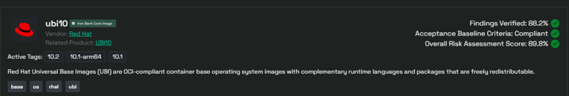
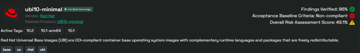
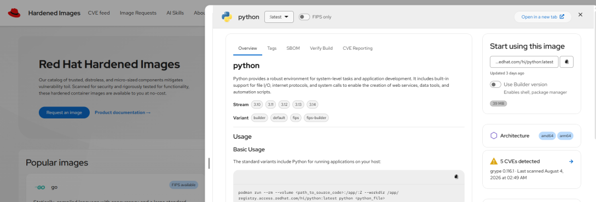

# Container Template


[TOC]

## Deployment Standard

 *Standard:* [Container Standard](./020_Container_Standard.md)

### Objective

This document serves as a living standard and team contract between Information Technology (IT) teams to ensure containers destined for Naval Oceanographic Office (NAVOCEANO) enterprise networks are secure, repeatable, and reusable. These standards act as a binding agreement between party members of the development, engineering, cybersecurity, and infrastructure teams. While these teams are often disparate, they are collapsed into general groups for the purpose of this document: infrastructure team (system engineers, technicians, and system administrators), cybersecurity team (system engineers, information system security officers, cybersecurity analysts, system administrators, software developers), and developers (system engineers, infrastructure technicians, software engineers).
Team members may have responsibilities in one or more areas, as the command dictates.

The following topics are addressed in this document:

 - Approved locations to fetch base container images (Registry control)
 - How to secure base images (Hardening & minimal footprints)
 - Proper scanning methods and artifacts (CVEs, SBOMs, and Attestations)
 - How to handle secrets and sensitive data required by containers
 - How to externalize configurations in containers for ease of adjudication and reuse
 - How to ensure auditing and logging trails (standardized formatting and output)
 - How to ensure Public Key Infrastructure (PKI) is implemented correctly
 - How to provide storage safely (read-only file systems, volumes, and ephemeral storage)
 - How to deploy and protect TCP and UDP services safely and route them (ports and service mesh integration)
 - How to enforce infrastructure runtime policies (resource allocation and admission control)
 - How to manage a container’s lifecycle
 - What minimum body of evidence (BOD) are required for delivery

### Registry Control
Teams must strive to inherit pre-built and secured containers when available. There are a few approved registries to pull images from on NIPRNET:
-
 - [AirForce Iron Bank: https://ironbank.dso.mil/repomap](https://ironbank.dso.mil/repomap)
 - [RedHat Hardened Images: https://images.redhat.com/](https://images.redhat.com)

#### Iron Bank

Images located Iron bank in this registry should not be assumed to be secure or compliant. Each image must be vetted prior to use. Please see Figure 1 and Figure 2 for examples of acceptable and unacceptable images.






Images that are acceptable for use in the Iron Bank must have an Acceptance Baseline Criteria status of Compliant. Users of these images are required to maintain awareness of their compliance and patch levels.

#### Red Hat Hardened Images

RHEL’s catalog of trusted, distroless, and micro-sized components mitigates vulnerability concerns. Scanned for security and rigorously tested for functionality, these hardened container images are available to you at no cost. Embedded with each image references are a multitude of criteria to evaluate.



#### Other External Registries

While external images are not expressly forbidden, they must go through the same vetting and security process as the images provided by your Base Images. External containers may be submitted into an GitLab project and registry to be adjudicated. Specific adjudication requirements and methodologies are discussed below.

Appendix 6 of the Container Hardening Guide, Version 1 documentation indicates the status and level of trust applicable to each source for container images.

### Hardening & Minimal Footprint

#### Hardening

All containers must include applicable Security Technical Implementation Guide (STIG) documentation, checklist and required artifacts that precipitate from checklist completion, delivered with them and saved within the GitLab repository they are associated with. For example, A web application should have the Application Security Development (ASD) checklist and associated documents saved. It is applicable to inherit checklists from Operating System (OS) and Application Servers(Tomcat, Postgres, etc.…) from their respective repositories. Developers inheriting hardened containers are required to verify appropriate documentation prior to use by direct inspection and team leader final approval. New containers targeting Operations must utilize the System Owner’s Risk Management Framework (RMF) process. In the absence of concrete process definitions, a signed email sent to the System Owner from the project’s technical lead certifying inspection, load and use of a new container is required prior to operational use of subject container. If working through an infrastructure team the email would be sent to subject team lead with the infrastructure team lead employing whatever process required by the System Owner

For example, a web application must have the ASD checklist, Web Server SRG (or Apache 2.4 Server STIG/NGINX Server STIG) and Web Site SRG (or Apache 2.4 Site STIG/NGINX Site STIG), Application Server SRG (or JBoss STIG/Wildfly STIG) and all other appropriate documents alongside it. It is possible to inherit checklists and configurations from the provided baseline images, but inheritors are required to validate all documentation and configurations prior to inheritance and usage.

#### Minimal Footprint

Docker build files should be named Dockerfile and located at the highest applicable level, folder / directory, for the build. Builds should be conducted utilizing a multistage approach to avoid the pollution of the final image. Think of the “layer cake” approach as building a container image by stacking thin, reusable layers on top of each other, instead of dumping everything into one big blob. Each instruction in your Dockerfile (like FROM, RUN apt-get install ..., COPY requirements.txt, RUN pip install -r requirements.txt, COPY src/) creates a new layer with its own filesystem.

These layers stack like a cake: a base layer (OS tools), then runtime (Python / Node / etc.), then dependencies, then your application code, and maybe configuration settings. Because layers are cached and reused, if you only change the top layer (your app code), Docker can rebuild quickly by reusing the lower layers (OS, runtime, dependencies). Each concern (base OS, language runtime, dependencies, app code) is in its own layer, making builds faster, images smaller, and reuse easier.

Additional considerations to include the use of variables, tags, cache removal, copy vs add command, and port exposure please see the Iron Bank's Dockerfile requirements guide.

As per the Container Hardening Guide, Version 1, Dockerfiles should not download any artifacts. Instead, a prephase step called Download will occur so the platform can download the required dependencies online. Then, the rest of the DOD Container Hardening process will operate in a disconnected and/or classified environment that does not have internet access. This will ensure the process will not be able to pull files from the internet that are required to build. See Appendix B: Example download.yaml for an example.

### Scanning and Artifacts

All projects that support containers must have a GitLab CI/CD pipeline that executes the multistage build of the docker file, applies all security configurations, software updates, and utilizes a CVE scanner (e.g., Grype), Antivirus scan (e.g, Clam AV), and generates a Software Build of Materials (e.g., Syft). The outputs of these scans will be posted as artifacts and accessible via GitLab Pages.

STIG documentation should be placed in a folder within the repository named `STIGs`.

#### Common Vulnerabilities and Exposures (CVE) Scan

CVEs are a database of publicly disclosed computer security flaws. Grype (https://oss.anchore.com/docs/guides/vulnerability/getting-started/) is our preferred open-source CVE scanner.
Prior to using Grype, the update command must be ran on the vulnerability database (grype db update). All CVE scans should be output in table format for ease of viewing.

#### Antivirus Scan

Antivirus scans are mandatory part of security and compliance. Clam AV (https://docs.clamav.net/ ) is the team’s preferred anti-virus scanner.
Scan should be incorporated into the CI/CD pipeline as per DoW Enterprise DevSecOps Fundamentals, v 2.5, 2024/10.

Prior running a scan, the antivirus database must be updated by executing `freshclam -u root || true`.

To execute a scan, a temporary container must be created and the container to be scanned is then mounted and scanned using the clamscan command.

Results will be saved and linked to the main GitLab Pages documentation.

#### Software Build of Materials (SBOM) Generation

A SBOM must be generated per container. SBOMs provide a list of all software and their versions installed within a container. [Syft getting started](https://oss.anchore.com/docs/guides/sbom/getting-started/) is the team’s preferred SBOM generation tool.

A Software Bill of Materials (SBOM) is not a technical configuration check inside a traditional Security Technical Implementation Guide (STIG), but it is requested by the Defense Information Systems Agency (DISA) during the formal vendor STIG development and product assessment process as part of Executive Order 14028(Improving Nations Cybersecurity).
STIGs vs. SBOMs

 - **STIGs:** Focus on operational settings, host configurations, and access controls for deployed software and hardware.

 - **SBOMs:** Focus on supply chain transparency, listing internal dependencies and third-party libraries.

##### Why You Still Need Both:

  - **Vendor Process:** When requesting a new STIG from Cyber Exchange, DISA requires comprehensive SBOM once development officially starts.

  - **Federal Mandates:** Separate federal rules (like Executive Order 14028) mandate SBOMs for software sold to the U.S. government, running parallel to STIG hardening requirements.

Link your SBOM output to the GitLab Pages references previously discussed.

#### STIG Documentation

All relevant STIG documentation must be within the repository for teams to review and users to inherit.

Each repo must contain at least one STIG v3 formatted STIG document (\*.cklb).

#### Minimal Artifact List

See Appendix B – Folder Structure for the structure and enumerated list of artifacts required.

### Environment Variables

All environment variables will contain a three-part nomenclature :

`<acronym of project>_<subject>_<purpose or verb>`

#### Component Breakdown

* `<acronym of the project>`: The common acronym used for the project in all capitals.
* `<subject>`: What is being represented?  PostgreSQL, vLLM, etc.?  All capitals.
* `<purpose or verbe>`: The purpose of the variable or a verb that describes how the variable will be used.  All capitals

#### Final Output Example

 - `PRJ_POSTGRESQL_PASSWD`
 - `PRJ_POSTGRESQL_USERNAME`

### Secrets and Configuration Externalization

 When possible, teams must use secrets management tools to store, rotate, and utilize secrets to ensure they remain in FIPS-140-2/3-compliant encrypted states (at rest, in flight) whenever possible.

 Secrets should be deployed in the container runtime/management stack of choice (Docker/Podman/Kubernetes secrets). Secrets are sensitive information that must not be deployed via plain text in any format.

 Examples include usernames, passwords, database connection strings, TLS certificates, keys, encryption passphrases, or other sensitive information.

 Container configurations may take place through files that are mapped from the hosting system into the container, or via environment variables. Environment variables must take precedence over mapped configurations and are preferred for context- or environment-specific configurations.

 Never store secrets or other sensitive information in an environment variable or configuration file. They must be stored in the runtime platform’s secret management tools. If a secrets management is unavailable the environment, <>…

 TruffleHog scans for secrets and keys in commits pushed to the remote. If there is a finding, a command is logged to demonstrate how to run the scan locally, to see the finding(s).

 Note that your .gitignore setup shold include consideration for secrets and not including those files in the repository.

### Logging

A container must log all data required by the base operating system (e.g., Red Hat Enterprise Linux, Debian, etc.) DISA STIG as well as all log or audit information required by the applicable software STIG (e.g., Apache 2.4, NGINX, PostgreSQL, etc.)

If provided, all logs must be written to the container platform for logs to be forwarded to a centralized log server. If the platform does not have this capability, or it is otherwise unavailable, all logging must be sent to a /var/log directory within the pod. The directory must be mounted via an external volume / mount / persistent volume claim (pvc) with least privileges so the hosting platform has access to aggregate and report the logs.

### Certificates

Containers will utilize a certificate from the host machine per container (each container) required, matching with CA of infrastructure. Any additional applications certificates need to have all usage and requirements documented. Negotiation with the N6 team is required for additional certificates outside the Host machine. Each container should utilize secrets and env vars to define location of certificates and stores.

### Volumes / External Mounts / Persistent Volume Claims

A Persistent Volume Claim (PVC) is a request for storage in a Kubernetes cluster made by a user or an application.

#### How PVCs WorkAbstraction:

 - **Abstraction:** Developers request storage size, access modes, and storage classes without needing to know the underlying physical infrastructure.

 - **Binding:** Kubernetes matches the PVC to a suitable Persistent Volume (PV) available in the cluster and binds them together.
 
 - **Mounting:** Pods reference the PVC in their configuration, mounting the durable storage directly into a container's file system path.
 
 #### Key Benefits
 
  - **Persistence:** Data survives pod restarts, crashes, and deletion.
  
  - **Portability:** Storage requests remain independent of specific cloud providers or hardware implementations.
  
  - **Decoupling:** Administrators manage storage pools while developers consume them as needed.

External volumes must not be defined in the Dockerfile. They must be defined in the orchestration tool used by the container platform (e.g., Docker Compose, Kubernetes Helm Charts, etc.).

### Networking/Routing

A container’s Dockerfile (or equivalent) must `EXPOSE` ports that will be opened, even if they are not utilized by the orchestration platform. Any ports exercising `EXPOSE` must adhere to approved ports in the Ports, Protocols, and Services Manual (PPSM). If a port need to be used that is not registered in the PPSM or is disapproved, it must be documented with the infrastructure’s cybersecurity team.

Coordination with the System Owner is expected for multi-container deployments with overlapping ports. If working with an infrastructure team ask to see their policy and schedule of available ports.

### Runtime Policy

All containers must be restricted on their orchestration platform to ensure they do not take more resources or have more privileges than strictly required for the service or application to run.

#### Non-Root Execution

Containers may never run as root. If root is required by a container for execution, it must be explicitly permitted by the cybersecurity team and for a limited amount of time if possible.. As per DoW Enterprise DevSecOps Fundamentals: The Container Image Must Be Created to Execute as a Non-Privileged User Containers must run as a non-privileged account as per IA Control: AC-6 (10) CCI: CCI-002235.

##### Build-Time Requirement

All Dockerfiles must explicitly switch user execution to a non-root user via the **USER** instruction prior to the **ENTRYPOINT** or **CMD**. It is highly recommended to use a specific, high-numbered User ID (UID) and Group ID (GID) (e.g., USER 10001:10001) rather than just a username.

Every container or service within a container swarm must get a unique UID and GID per the centeralized user authentication store to ensure logging and auditing is correct throughout all systems.

##### Runtime Requirement

Deployment manifests (e.g., Kubernetes PodSpecs, Helm charts, Docker Compose files) must explicitly set the container Security Context to enforce non-root execution (runAsNonRoot: true).

#### Prevention of Privilege Escalation

Containers must not be allowed to gain more privileges than they were initially granted. All deployment configurations must explicitly disable privilege escalation (allowPrivilegeEscalation: false). Base images should have setuid and setgid bits removed from binaries where possible during the image build process to prevent processes from elevating their permissions internally during the run stage.

#### Resource Quotas and Limits

All containers must have a strict limit for CPU allocation, memory allocation, and inode allocation to prevent resource starvation on the container host. If supported by the container platform, a network quality of service (QoS) policy must also be applied to restrict the amount of network bandwidth available to a container.

### Image Lifecycle

Containers are living entities that must be regularly maintained to address CVEs and patches. They must be actively managed as any other compute resource within an environment.

#### Continuous Rebuilding (Mitigating Base Image Drift)

 - Applications must not rely on outdated, vulnerable base images simply because the application code itself has not changed.

 - Scheduled Rebuilds: CI/CD pipelines must be configured to automatically rebuild, rescan, and push all active containers on a regular cadence (at least every 7 days), regardless of whether application source code has changed.

 - Base Image Triggers: Where possible, pipelines must subscribe to webhook events from the base image registry to automatically trigger a rebuild whenever a new, patched version of the base image is published.

##### Tagging and Versioning Strategy

Containers must use semantic versioning. Always.

Image tags represent immutable snapshots in time. We do not permit overwriting tags, since that destroys traceability, roll-back capabilities on orchestration platforms, and can lead to configuration drift or worse.

Using the ‘latest’ tag or other mutable tags (e.g., ‘dev’, ‘prod’, etc.) is ***expressly forbidden*** for base image creation and usage. BoE artifacts are tied to specific image tags with specific git SHA fragments and must match for traceability.

Example: Updates push <BASE IMAGE> to version 1.2.0 through a git commit with a SHA256 fragment abcd1234. The resulting tag would be v1.2.0-abcd1234.

#### Registry Retention and Pruning Policies

Container registries can quickly become bloated, leading to increased storage costs and larger attack surfaces. Self-hosted registries must enforce automatic cleanup policies.

 - **Untagged Images:** Any image layer that becomes orphaned or untagged will be automatically purged after 7 days.
 
 - **Stale Images:** Older versions of application images that are not currently running in any environment will be retained for a maximum of 90 days before being purged.

 - **Release Retention:** Teams must ensure that at least the last 3 to 5 known-good release versions are retained in the registry to facilitate rapid rollbacks.

#### Vulnerability Degradation & SLA Response

A running container that was previously compliant may fall out of compliance if a new Critical or High CVE is published against its components (e.g., a zero-day vulnerability).

 - **Continuous Scanning:** As described above, containers in the repository will be scanned every 7 days at minimum. Deployed containers will be subjected to continuous runtime vulnerability scanning by cluster security tools.

 - **Patching SLA:** Upon notification of a discovered Critical vulnerability with a known fix in a running container, the team must rebuild the image with the patched dependencies, successfully pass the CI/CD pipeline, and deliver the updated image for deployment within 7 days.

 - **End-of-Life (EOL) Components:** No container may be deployed if it relies on a framework, language, or base OS that has reached its official End-of-Life and no longer receives upstream security patches. Verification through the SBOM will be performed during scan cycles.

### Appendix A: Base Container Delivery Checklist

**Base Container Delivery & Compliance Checklist**

Project / System Name: <input type="text" placeholder="Project / System Name...">

Version / Tag: <input type="text" placeholder="Version / Tag information...">

Target Environment(s):<input type="text" placeholder="Enter the envrionments you're targetting.">

1. Image Origin & Architecture

 - [ ] Approved Base Image Origin

**Requirement:** The base image was pulled exclusively from the DoD Iron Bank or an approved internal authenticated registry mirror.

 - [ ] Deterministic Tagging
 
**Requirement:** The image is tagged with semantic versioning and the Git commit SHA (e.g., v1.2.3-adef3456). The mutable :latest tag is not used.

2. Container Hardening & Build

 - [ ] Non-Root Execution
 
**Requirement:** The Dockerfile explicitly switches execution to an unprivileged user (preferably using a specific UID/GID like USER 10001:10001) before the ENTRYPOINT or CMD.

 - [ ] Multi-Stage Build
 
**Requirement:** Multi-stage builds are used to ensure build-time compilers, SDKs, and raw source code are excluded from the final runtime image.

 - [ ] OS Packages Updated
 
**Requirement:** All operating system packages were updated to their latest secure versions during the build process to eliminate known base-layer vulnerabilities.

3. Security Scanning & Compliance Artifacts

 - [ ] Vulnerability Scan Passed
 
**Requirement:** The container was scanned in the CI/CD pipeline and contains zero Critical or High CVEs (or an approved POA&M is attached for unpatched findings).

 - [ ] SBOM Generated
 
**Requirement:** A Software Bill of Materials (SBOM) in CycloneDX or SPDX format is attached as a pipeline artifact.

 - [ ] Secret Scan Passed
 
**Requirement:** Automated scanning confirms no hardcoded credentials, API keys, private keys, or tokens are embedded in the image layers.

 - [ ] Image Signed

**Requirement:** The final image has been cryptographically signed (e.g., using Cosign) to verify provenance and build integrity.

4. Configuration, Secrets, & Logging

 - [ ] Externalized Configuration

**Requirement:** All application configurations are read from environment variables or mounted configuration files; no configurations are hardcoded.

 - [ ] Standardized Logging

**Requirement:** The application writes all logs exclusively to stdout and stderr in a structured format (preferably JSON). No local log files are generated.

 - [ ] PKI/Certificates

**Requirement:** The image trusts DoD Root CAs, and application-specific SSL/TLS certificates are configured to mount dynamically at runtime rather than being baked into the static image, if applicable.

5. Runtime & Orchestration Readiness

 - [ ] Read-Only Root Filesystem

**Requirement:** The container has been verified to run successfully with a read-only root filesystem (readOnlyRootFilesystem: true).

 - [ ] Ephemeral Storage

**Requirement:** Any required temporary files are directed to a specific memory-backed volume (e.g., an emptyDir mount at /tmp).

 - [ ] Unprivileged Ports

**Requirement:** The application binds to non-privileged ports (>1024).

 - [ ] Security Context Compliance

**Requirement:** The deployment manifest drops all default kernel capabilities (drop: ["ALL"]) and explicitly sets allowPrivilegeEscalation: false.

List privileges and why they are required for this container to operate.

 - [ ] Resource Bounds

**Requirement:** CPU and Memory Requests (guarantees) and Limits (ceilings) are explicitly defined.

### Appendix B – Folder Structure

|Folder Name / Location | Description |
|-----------------------|-------------|
|`./Dockerfile`         | File using the base approved image and hardening the container by using Dockerfile INSTRUCTIONS.|
|`./README.md`          | README file to describe the container, warn if this is a commercial product or not, etc. |
|`./scripts`            | Scripts are used explicitly for the purpose of setting up (hardening) the container. (***Optional***).|
|`./config`             | Any configuration files used to support the container. (***Optional***)|
|`./documentation`      | Documentation related to the container proper. All documentation should be in Portable Document Format (PDF) or Markdown (\*.md).|
|`./STIGs`              | Checklist in \*.cklb format and any other documentation deemed necessary by the System Owner in Markdown (\*.md) format.|
|`./compliance`         | Results from Scan tools will be copied into compliance folders as HTML files. As Grype are widely available and can be run by anyone, the scan results are NOT considered FOUO.|
|`./accreditation`      | Risk Management documentation created by the team to document findings, false positives, accepted risks, and current container risk posture.|
|`./example`            | Examples can be added to support container adoption and/or reuse.|
|`LICENSE`              | Each hardened container requires a file that describes the licensing required to run the container (LICENSE). README.md will also indicate if a product requires a commercial license. |
|`Changelog`            | Changelog will be added to both repositories’ subfolders and updates as appropriate. Format will be in markdown with the following as an example as a changelog entry.|
|`Download.yaml` or `Download.json`| File listing everything to be downloaded from the internet to build the container; it can include application binaries. See Appendix C: Example download.yaml for reference.|

**Example `Changelog` Entry:**

```
2026-08-04
Added
* **Multi-stage builds** to reduce final image size from 850MB to 120MB.
* **Healthcheck instruction** in the Dockerfile monitoring `/health` endpoint.
* **Non-root user (`appuser`)** execution for enhanced container security.
Changed
 * **Base image** updated from `node:20` to `node:20-alpine`. * **Bundled configuration** moved to environment variables via `ENV`.
Fixed
 * **Zombie process reaping** by adding `tini` as the container entrypoint init.
 * **Permission denied error** when writing to the internal `/data` volume.
```

### Appendix C: Example download.yaml

#### Code Example of download.yaml
```
apiVersion: "1"
name: "example-container"
mil.dso.ironbank.product.name: "example"
version: "1.0.0"
release: "1"
# List of external dependencies and resources for the offline build context
resources:
  - filename: "lrsql.zip"
    url: https://github.com/yetanalytics/lrsql/releases/download/v0.9.3/lrsql.zip
    validation: type: "sha256"
    value: "b6b6926ef02888effe69fa595c788d2f57ba8cba58f7cce6f95b5683067ea4c9"
  - filename: "config-bundle.tar.gz"
    url: "https://example.com"
    validation: type: "sha256"
    value: "7e4697d958bd9f389d9f809f398d0fff97d048c975a442db065ae32102f713ed"
maintainers:
  - email: "maintainer@example.com"
    name: "John Doe"
    username: "johndoe"
```
#### Key Rules for External Dependencies

 - **No Versioned Filenames:** Omit specific version strings in the filename property (e.g., use tool.tar.gz instead of tool-1.2.3.tar.gz) so your Dockerfile copy commands do not break on automated version bumps.

 - **Checksum Validation:** Every resource must specify a cryptographic verification block using sha256 or sha512.

 - **Pipeline Integration:** You can review pipeline stage implementation details and pipeline execution guidelines directly in the [Iron Bank Pipeline Documentation](https://repo1.dso.mil/ironbank-tools/ironbank-pipeline/-/blob/823-pipeline/README.md) as a reference implementation

 ### Appendix D: Glossary

 **ClamAV** - A free, open-source antivirus engine developed by Cisco Talos used to detect malware, Trojans, and viruses. It features a command-line scanner, a multi-threaded daemon, and an automatic database updater.

 **Continuous Integration and Continuous Delivery/Deployment (CI/CD)** - An automated pipeline that takes code from a developer's commit all the way to running in production, with minimal manual steps. Put together, a CI/CD pipeline is the automated workflow (build → test → deliver → deploy) that replaces manual releases with a repeatable, fast, and reliable process.

 **Continuous Integration (CI):** Every time developers push code changes, it's automatically merged into a shared codebase and immediately built and tested (unit tests, integration tests, etc.), so problems get caught early instead of piling up.

 **Continuous Delivery (CD):** Once code passes CI, it's automatically packaged and staged so it's always ready to release to any environment (like test, staging, or production) at any time.

 **Continuous Deployment (the other "D")** - Automatically pushing every change that passes tests straight into production, with no human sign-off required.

 **Container** - Is a packaged, isolated environment that has everything an app needs to run, so it behaves the same no matter where you run it. Containers allow putting your application in a self-contained box that includes the app code, runtime, libraries, and system tools it needs. Multiple containers can run on the same host, sharing the OS kernel, but each one is isolated from the others, so their configs and dependencies don’t conflict. An image is the blueprint/template; the container is the running instance of that image.

 **Development, Security, and Operations (DevSecOPs)** - Regular DevOps focuses on speed: developers and operations teams collaborate closely, automate builds/tests/deployments, and ship software fast. DevSecOps adds security as everyone's job throughout that whole pipeline, not just a final gate handled by a separate security team right before release. This is often called "shifting left": instead of testing for vulnerabilities only at the end, automated security checks (like code scanning, dependency checks, vulnerability scanning) run continuously in the CI/CD pipeline, from planning and coding through build, test, and deployment. DevSecOps platforms are expected to be instantiated from hardened IaC code and scripts or DoD hardened containers from a DoD artifact repository like Iron Bank, a hardened container image repository and one of Platform One’s value streams, see references on page 16.

 **Executive Order 14028, Improving the Nation's Cybersecurity** - Improving the Nation's Cybersecurity," was a sweeping 2021 directive designed to modernize federal IT, secure the software supply chain, and improve threat sharing. Though it was later rescinded and replaced by subsequent administration policies, its core frameworks continue to heavily influence modern compliance.

 **Git** - Git is a distributed version control system, a tool that tracks every change made to a project's files over time, so you can see history, collaborate with others, and undo mistakes. Every time you save a set of changes (a commit), Git takes a snapshot of your project at that moment, so you always have a full history you can look back at or revert to. Git is distributed, meaning every developer has a full copy of the project's history on their own machine, not just on a central server, so you can work offline and sync up later. Git supports branching, letting you work on a new feature or fix in isolation without disturbing the main codebase, then merge it back once it's ready.

 **GitLab** – A Git oriented web-enabled ecosystem supporting software development.
 
 **GitLab Pages** - Static websites directly from a repository in GitLab. These websites:
 
 - Deploy automatically with GitLab CI/CD pipelines.
 - Support any static site generator (like Hugo, Jekyll, or Gatsby) or plain HTML, CSS, JavaScript, and Wasm.
 - Run on GitLab-provided infrastructure at no additional cost.
 - Connect with custom domains and SSL/TLS certificates.
 - Control access through built-in authentication.
 - Scale reliably for personal, business, or project documentation sites.

 **Grype** - An open-source command-line tool created by Anchore that scans container images, directories, and software bills of materials (SBOMs) for security vulnerabilities. It supports major operating systems and language packages, and pairs with Syft for inventory generation.

 **Iron Bank** - Iron Bank is a United States Air Force approved platform that helps you make informed risk decisions before deploying your software. With transparent risk assessments, including an Overall Risk Assessment (ORA) score and detailed vulnerability reports, you can effectively evaluate your software security. Iron Bank provides reprocity approved container images for DoW stakeholders. Every container image is scanned daily for vulnerabilities, and vendors can update and patch images as risks are identified. This approach ensures that your team works with the most up-to-date, resilient tools available.

 **Risk Management Framework (RMF)** - A structured way for an organization to consistently deal with risk instead of reacting ad-hoc. The RMF is represented as a set of steps and rules that tell you how to identify, assess, reduce, and keep an eye on risks (like cybersecurity threats to IT systems). The RMF is used to build risk into the system lifecycle, so security and privacy are considered from design through operation, not bolted on at the end. The RMF is usually built around repeating core activities: identify risks, analyze impact/likelihood, choose and implement controls, authorize/accept risk, then continuously monitor and update.

 **Security Technical Implementation Guide (STIG)** - A Security Technical Implementation Guide (STIG) is basically a detailed checklist for how to lock down a specific piece of technology so it’s safe to use on DoD and related government networks. The STIG acts as a configuration standard that says exactly how a product (OS, database, web server, application, device, etc.) must be set up to meet required cybersecurity. Each STIG is specific to a product and version and lists all the security requirements that apply to that product in the DoD environment. The goal is to reduce known vulnerabilities and make systems as hard as possible to attack, by standardizing secure installation, configuration, and maintenance.

 **System Owner** - The person (or organization) that is ultimately responsible for an information system for its whole life, not just the tech pieces. They are accountable for how the system is procured, built, configured, run, maintained, and retired. The System Owner makes sure the system meets cybersecurity and compliance requirements, works for the mission/business, and has the resources it needs (people, budget, tooling). System Owners own the risk and decisions: if something goes wrong with that system’s security or availability, this is the role leadership looks to.

 **Syft** - A CLI tool and Go library for generating a Software Bill of Materials (SBOM) from container images and filesystems. Exceptional for vulnerability detection when used with a scanner like Grype.

 **TruffleHog** - TruffleHog is a secrets Discovery, Classification, Validation, and Analysis tool. In this context, secret refers to a credential a machine uses to authenticate itself to another machine. This includes API keys, database passwords, private encryption keys, and more. TruffleHog can look for secrets in many places including Git, chats, wikis, logs, API testing platforms, object stores, filesystems and more. TruffleHog classifies over 800 secret types.
